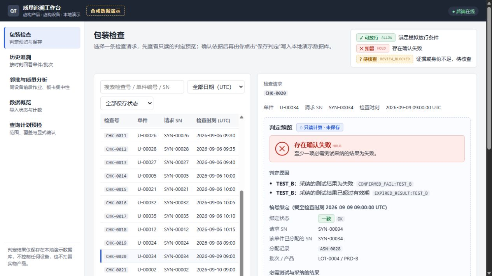
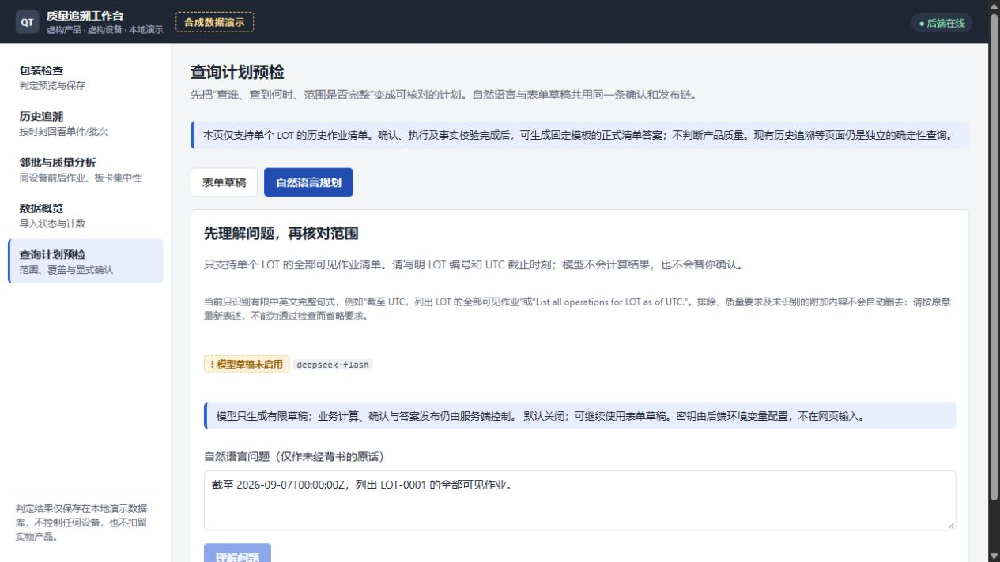
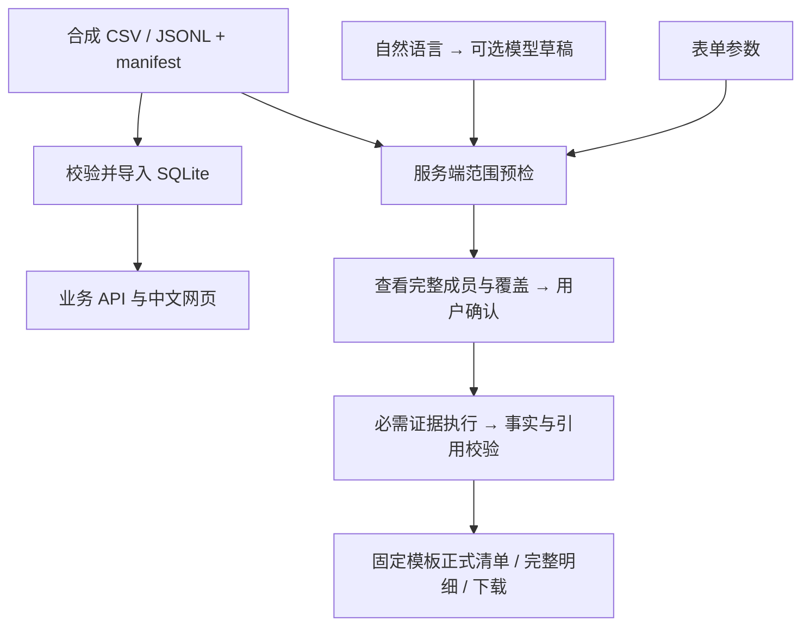

# Factory Quality Demo

**使用合成数据的制造质量追溯与受控 AI 查询演示。**

项目把批次、单件、作业、测试、更正记录和设备关联起来，提供中文业务网页、本地 HTTP API 和命令行。可选 DeepSeek 模型负责把受支持的问题转成查询草稿；范围确认、计算、证据校验和最终答案由服务端确定性代码完成。

数据、产品、设备、编号、测试关卡和规则全部虚构。`TEST_A / TEST_B / TEST_C` 是抽象测试关卡，不代表具体工艺或真实检测标准。本项目用于展示数据建模、时间追溯和 AI 应用的信任边界，不控制设备，也不执行实际产品放行。

## 可以体验什么

| 页面 | 功能 | 关键规则 |
| --- | --- | --- |
| 包装检查 | 浏览请求、只读预览模拟判定、显式保存事件 | 预览不写库；重复保存复用事件；失败与过期同时保留 |
| 历史追溯 | 按单件、SN 或 LOT 查询指定 UTC 时刻的作业和测试 | 不提前使用迟到记录；采用当时可见的更正版本；SN 冲突需选候选 |
| 邻批与质量分析 | 按设备和时序查询相邻作业，查看覆盖率与载具集中性 | 统计绑定 operation_id；缺失不算通过；同时展示失败数、尝试数及失败率 |
| 数据概览 | 查看导入状态、计数和已保存判定 | 一个数据库绑定一个输入快照，重复导入幂等 |
| 查询计划预检 | 填表或用可选模型草稿，确认范围后生成完整作业清单 | 发现、覆盖、证据、事实和最终发布分别检查 |

默认关闭模型，不需要 API Key 就能运行全部确定性页面和表单查询流程。

## 页面预览

只读包装检查：确认失败与过期并列展示。



查询计划页面：模型默认关闭，网页不接收密钥。



## 技术结构与 AI 边界

| 部分 | 实现 |
| --- | --- |
| 数据处理 | Python、CSV/JSONL 完整性校验、SQLite、参数化 SQL |
| API | FastAPI、Pydantic、Uvicorn；回环监听与 Host/Origin 检查 |
| 网页 | React、TypeScript、Vite、手写 CSS；请求守卫隔离过期响应 |
| 执行 | 固定只读 Python worker，有限重试、截止时间、取消与执行账本 |
| AI | DeepSeek 官方 HTTPS API、严格结构化草稿；默认关闭 |
| 答案 | 服务端事实注册、语义引用校验、固定模板、分页与完整 JSON 下载 |

业务页面通过 API 查询本地 SQLite。受控 LOT 清单链使用重新校验的不可变源文件快照，核对其身份与导入数据库一致后建立证据。



当前自然语言只支持一个意图：**一个确切 LOT，截至显式 UTC 时刻的全部可见作业**。模型不接收数据库行或会话历史，不生成 SQL，不决定分母，不编写最终结论，也没有确认、执行或发布权限。

1. 服务端检查完整句式、唯一 LOT 和时间；排除、否定、质量附加条件或未知尾句不能悄悄改查全集。
2. 模型只能给出 `intent_key / lot_id / as_of`，服务端严格核对原文与 Schema。
3. 服务端核验发现分页、成员集合、快照覆盖和契约版本；用户查看完整成员再确认。
4. 执行器从确认计划取参数并收齐必需证据，事实层检查实体、时刻、计数域及全部强制事实。
5. 固定模板生成正式清单；读取、翻页和下载重新检查资格。

`verified_answer` 表示清单通过受限范围的证据校验，**不表示产品质量合格**。覆盖声明只适用于封闭合成场景，不能证明真实系统没有漏采事件。有限句式可能误拒，不能保证任意自然语言绝对正确。

## 快速开始

### 环境

- Python 3.11+；已记录验证环境为 Windows x64 / Python 3.13.14。
- 前端构建要求 Node.js 20.19+ 或 22.12+；前端测试需 Node 22.18+ 或 23.6+。建议 Node 24 LTS 或更新的受支持版本。
- 已记录前端验证环境为 Node 26.4.0 / npm 11.17.0；其他系统与版本没有本轮完整安装验证。
- CLI 业务计算仅使用 Python 标准库；API 和完整测试需安装依赖。

### 1. 获取源码

```shell
git clone https://github.com/lkdx0220/factory-quality-demo.git
cd factory-quality-demo
```

### 2. 安装并启动后端

Windows PowerShell，在项目根目录运行：

```powershell
python -m venv .venv
.\.venv\Scripts\python.exe -m pip install -r requirements-dev.txt -c requirements-lock.txt
.\.venv\Scripts\python.exe scripts/serve_api.py
```

macOS / Linux 的命令形式如下；这些平台尚未进行完整兼容性验收：

```shell
python3 -m venv .venv
.venv/bin/python -m pip install -r requirements-dev.txt -c requirements-lock.txt
.venv/bin/python scripts/serve_api.py
```

只运行 API 可改装 `requirements-api.txt`。`requirements-lock.txt` 是依赖版本约束，不是带 wheel 摘要的跨平台锁文件。

保持后端终端运行。默认地址为 [http://127.0.0.1:8000](http://127.0.0.1:8000)，交互式 API 文档为 [http://127.0.0.1:8000/docs](http://127.0.0.1:8000/docs)。启动不会自动导入数据。

### 3. 启动网页

另开终端，在项目根目录执行：

```shell
cd frontend
npm ci
npm run dev
```

打开 [http://127.0.0.1:5173](http://127.0.0.1:5173)。首次使用点击“初始化演示数据库”，随后可以浏览 22 条包装检查请求。数据库与判定写入本机 `local/`，随包 CSV 不变。

前端通过 `/api` 代理连接后端，仅改写来自自身页面的 Origin；其他来源仍由后端拒绝。服务面向本机，随机会话隔离不构成企业认证，不应直接暴露公网。

### 4. 体验示例

1. **包装检查**：打开 `CHK-0020`，查看 `HOLD`，及 `CONFIRMED_FAIL:TEST_B`、`EXPIRED_RESULT:TEST_B`。预览不保存，点击“保存判定”才写事件。
2. **历史追溯**：查询 `U-00001`，时刻 `2026-09-01T06:00:00Z`，只应看到当时可见的 `OP-0001`。
3. **邻批**：选 `OP-0003`，时刻 `2026-09-02T00:00:00Z`，前后各取 2；锚点为 6 通过 / 4 失败。
4. **范围预检**：表单输入 `LOT-0001`、`2026-09-07T00:00:00Z`，核对成员，确认、执行、生成事实、校验并发布。完整清单包含 `OP-0001 / OP-0002 / OP-0007 / OP-0012`。

`ALLOW` 表示满足模拟条件，`HOLD` 表示确认测试失败，`REVIEW_BLOCKED` 表示身份、规则或结果不足。身份或规则不确定时优先阻断；未知不能转成通过。

## 可选：启用 DeepSeek

在操作系统环境中配置 `DEEPSEEK_API_KEY`，从继承了该变量的新终端启动：

```powershell
.\.venv\Scripts\python.exe scripts/serve_api.py --enable-model
# 可选型号；默认 deepseek-flash
.\.venv\Scripts\python.exe scripts/serve_api.py --enable-model --model deepseek-v4-pro
```

应用不自动加载 `.env`。不要在源码、网页、截图或命令行参数中填写密钥。未带启用开关时，即使环境已有密钥也不发推理请求。启用后按服务商实际用量计费；一次提交最多一次请求，没有隐藏付费重试。

在“自然语言规划”输入：

> 截至 2026-09-07T00:00:00Z，列出 LOT-0001 的全部可见作业。

仅支持登记的有限中英文句式。缺时间、多个 LOT、任意子集、质量判断、相对日期或未登记语言可能澄清或拒绝。修改问题后重新生成草稿，不把旧结果当新问题答案。细节见 [模型规划](docs/model-planning.md)。

## API 与命令行

HTTP JSON 使用 `{ok, synthetic, data/error}`。`ok=true` 表示操作正常返回，不代表质量通过。只读预览与保存使用不同端点。

| 接口 | 用途 |
| --- | --- |
| `GET /api/v1/health`、`GET /api/v1/stats` | 服务和数据状态 |
| `POST /api/v1/ingest`，正文 `{}` | 校验并导入固定样本，重复调用幂等 |
| `GET /api/v1/lots`、`units`、`equipment`、`operations` | 分页浏览与限定筛选 |
| `GET /api/v1/checks/{id}/preview` | 只读判定预览 |
| `POST /api/v1/checks/{id}/evaluate`，正文 `{}` | 保存模拟判定事件 |
| `GET /api/v1/trace`、`concentration` | 历史追溯与载具集中性 |
| `GET /api/v1/operations/{id}/neighbors` | 按作业查询邻批 |
| `/api/v1/query-plans/...` | 草稿、预检、确认、执行、事实、发布和下载 |

完整参数、状态与错误码见 [API 文档](docs/api.md) 和运行时 OpenAPI。

无需网页也能执行 CLI。以下 `python` 指虚拟环境解释器，未激活时请换成完整相对路径：

```shell
python scripts/process_data.py ingest --batch data/batches/demo-v1 --db local/demo.sqlite3
python scripts/process_data.py stats --db local/demo.sqlite3
python scripts/process_data.py trace --db local/demo.sqlite3 --unit-id U-00001 --as-of 2026-09-01T06:00:00Z
python scripts/process_data.py neighbors --db local/demo.sqlite3 --operation-id OP-0003 --as-of 2026-09-02T00:00:00Z --before 2 --after 2
python scripts/process_data.py packaging --db local/demo.sqlite3 --check-id CHK-0020
```

最后一条会保存本地判定事件；仅预览请使用网页或只读 API。

## 数据模型

合成样本包含 **4 LOT、40 单件、14 次作业、106 次测试尝试、107 个记录版本、113 次投递**，其中 6 次重复投递不会变成额外测试。

| 表 | 内容 |
| --- | --- |
| `products`、`lots`、`units` | 产品、批次和单件身份 |
| `equipment`、`fixtures`、`fixture_bindings` | 设备、载具及带有效区间的位置绑定 |
| `operations` | 一次独立作业及进出站时间，重复作业单独计数 |
| `test_requirements` | 必需测试、有效期和过期规则 |
| `test_results` | 测试尝试及更正版本，PASS / FAIL / INVALID |
| `sn_assignments` | 编号分配及其记录时刻 |
| `packaging_checks` | 待检查请求 |
| `alarms` | 单件、作业、绑定及设备背景报警 |

`test_id` 标识测试尝试，`test_record_id + version` 标识记录版本。`recorded_at` 是记录可见时间，`as_of` 是业务历史截止时刻，不能用执行时刻互相替代。

十二张 CSV、一份 JSONL 投递流及清单位于 `data/batches/demo-v1/`，字段定义见 [csv-schema.json](schemas/csv-schema.json)。导入前验证发布状态、文件集合、SHA256、计数、字段、关联和投递一致性。一个数据库只绑定一个快照；布局仅支持十二表固定列，结构扩展需显式迁移。详见 [合成数据说明](docs/data-provenance.md)。

## 测试与构建

```powershell
# 项目根目录；不调用付费模型
.\.venv\Scripts\python.exe -m unittest discover -s tests -v

# frontend 目录
cd frontend
npm test
npm run build
npm run preview
```

预览地址为 [http://127.0.0.1:4173](http://127.0.0.1:4173)，仍需后端。`dist/` 不提交，使用构建物前应完成构建再启动 API；运行中改代码或构建物会使原契约束失效，需重启并新建计划。

已记录回归：后端 **172 项及 172 个子测试通过**，前端 **7/7**，TypeScript/Vite 构建通过。语句覆盖率 **87.85%**；本地 cq target A 门通过，未降低阈值或增加豁免。仍有 15 项中等、200 项低级静态发现，架构检查无契约而跳过。门禁通过不等于零告警或生产认证。

测试分组与边界见 [测试说明](docs/testing.md)、[对抗测试适用范围](docs/adversarial-acceptance.md)。`evaluation/nl-query-cases.json` 是合成语料；`scripts/evaluate_model.py` 仅显式使用 `--live-model` 才收费评测，输出含本地原始响应和数据库，应放在被忽略目录。

## 目录与文档

```text
src/mdlab_app/     确定性处理、API、规划、证据、事实与发布
frontend/         React 界面、请求守卫、测试和 Vite 配置
data/batches/     合成样本、投递流和 manifest
schemas/          CSV 字段合同
contracts/        封闭合成场景覆盖声明
scripts/          CLI、API 启动与显式模型评测
tests/            后端业务、协议、故障和对抗测试
evaluation/       合成自然语言评测问题
docs/             功能合同、测试范围及合成截图
local/            运行时数据库和状态，自动忽略
```

- [项目规格](SPEC.md)：业务规则、完整性约束与验收目标。
- [范围预检](docs/query-plan-preflight.md)：发现、可审查成员、覆盖、原子确认与契约束。
- [证据执行](docs/evidence-execution.md)：固定 worker、截止、重试、取消和账本。
- [事实与引用](docs/fact-registry.md)：强制事实、实体/时刻/语义校验。
- [答案发布](docs/answer-publication.md)：模板、完整明细、资格与导出边界。

## 常见问题

| 现象 | 处理方法 |
| --- | --- |
| 后端未连接 / 502 | 检查 API 是否运行在 8000；其他端口需在前端终端设置 `API_TARGET` 并重启 Vite |
| 数据库未初始化 / 503 | 点击初始化按钮，或执行固定导入 API / CLI |
| 5173 / 4173 已占用 | Vite 使用严格端口，结束自己启动的旧服务再启动 |
| 模型入口禁用 | 配置服务端环境变量，带 `--enable-model` 重启；网页不能设置密钥 |
| 计划过期、束失效、快照冲突 | 新建计划；更换输入时使用新数据库，不覆盖既有事件 |
| 想要全新本地状态 | 停止服务后用 `--db local/another-demo.sqlite3` 启动，不删除随包数据 |

更换端口示例：后端带 `--port 8001`；PowerShell 前端终端先设置 `$env:API_TARGET='http://127.0.0.1:8001'`，再 `npm run dev`。

## 当前边界

- 本地单用户、单 API 进程；不是多租户企业身份系统或云端生产部署。
- 自然语言限单 LOT 的完整作业清单；总体质量、子集、根因、任意 SQL、写回和设备处置不在模型权限内。
- 追溯仅显示每次测试在查询时刻的最新可见版本，不返回所有旧更正内容；返工标记由同批同工序次序推导。
- 设备背景报警和单件关联报警分开展示，时间重叠不等于根因。
- 计划有效期 1800 秒；后续访问重验，但已经显示或下载的内容无法追溯撤回。
- 合成覆盖、有限语料和小样本不能证明真实数据完整、任意语言无误或生产吞吐；不是完整 T01–T26、跨平台、真实满盘/断电验收。

## 许可证

源码、文档、合成数据和评测问题采用 [MIT](LICENSE)。依赖保留各自许可证，见 [第三方声明](THIRD_PARTY_NOTICES.md)。DeepSeek 托管服务及模型权重不属于本项目 MIT 授权范围。
